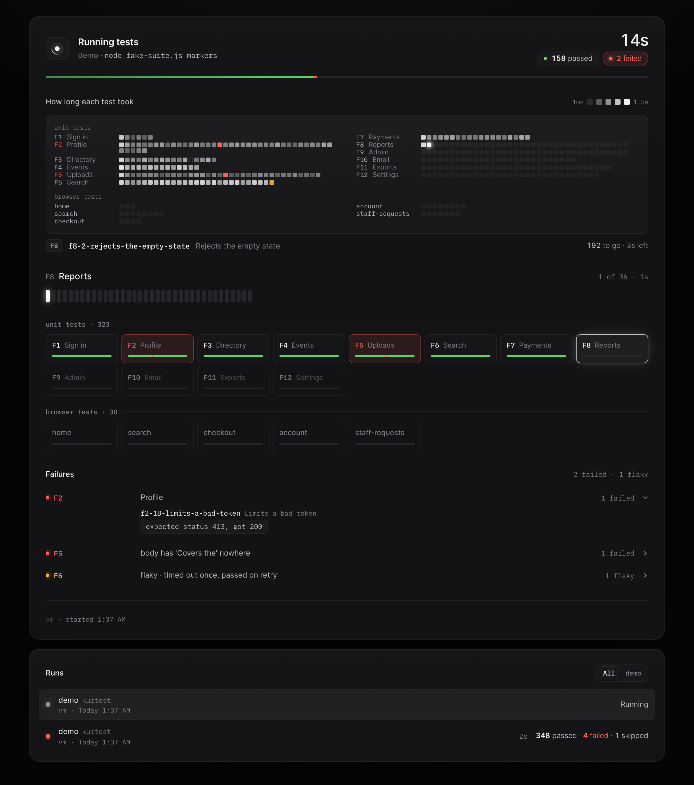

# KurTest

A live page for your test runs. Wrap any test command in `kurtest` and watch it in the browser as it happens: elapsed time and counts, tests finished per minute with a red line at each failure, the running group's ticks, a grid of every group, and each failure with its reason. Runs from any project and any machine can report to one page.



Node 20 or later. No dependencies. macOS, Linux and Windows.

## Try it

```sh
npx kurtest -- npm test
```

Any test command works in place of `npm test`. KurTest starts in the background, opens the page, and shows the run. Your terminal output and exit code stay exactly as they were.

To keep it:

```sh
npm i -g kurtest
kurtest service install      # start KurTest when you log in (optional)
```

## What it can read

| Your tests | What to do |
| --- | --- |
| Anything that prints TAP: Node's test runner (`--test-reporter=tap`), Vitest (`--reporter=tap`), Mocha (`--reporter tap`), pytest with `pytest-tap` (`--tap-stream`) | Nothing more. `kurtest -- <command>` notices TAP by itself. |
| Playwright | Add the reporter: `reporter: [['list'], ['kurtest/playwright']]` |
| A runner that prints one line per test | A few regex rules in `.kurtest.json` |
| Your own runner | Print `@@kurtest {json}` lines, or POST events over HTTP |

Recipes for each are in [docs/runners.md](docs/runners.md). Jest and JUnit XML readers are planned.

## Several suites, one run

Put a `.kurtest.json` in your project root and `kurtest` with no arguments runs every suite in it, in order, as one run:

```json
{
  "project": "my-app",
  "suites": [
    { "name": "unit", "command": "node --test --test-reporter=tap" },
    { "name": "e2e", "command": "npx playwright test" }
  ]
}
```

`kurtest e2e` runs just that one. From the second run on, the page lays out every suite before it starts and estimates the time left.

## Commands

| Command | What it does |
| --- | --- |
| `kurtest -- <command>` | Run a test command and report it |
| `kurtest [suite ...]` | Run the suites in `.kurtest.json` |
| `kurtest serve` | Run KurTest in this terminal instead of the background |
| `kurtest service install` / `remove` / `status` | Start KurTest when you log in (launchd, systemd or a Windows logon task) |
| `kurtest stop` | Stop a KurTest running in the background |
| `kurtest token` | Print the token, and a sign-in link for other devices |
| `kurtest init claude` | Make [Claude Code](docs/claude-code.md)'s test runs report to KurTest |

## One page for several machines

By default KurTest only listens on the machine it runs on. To have a laptop, a desktop and CI report to one page, run it on an always-on machine with `--host 0.0.0.0` (or in [Docker](docs/service.md#docker)), and point the others at it:

```sh
export KURTEST_URL=http://my-server:7357
export KURTEST_TOKEN=...        # `kurtest token` on the server prints it
kurtest -- npm test
```

[docs/remote.md](docs/remote.md) covers tokens, the local network, and reaching it from anywhere with Tailscale or Cloudflare Tunnel.

## Docs

- [Runners](docs/runners.md): reading each test runner's output, and `.kurtest.json`
- [Test convention](docs/convention.md): ids, groups, descriptions and reasons that make the page useful
- [Event format](docs/events.md): for writing your own reporter
- [HTTP API](docs/api.md): for building on top of KurTest
- [Remote access](docs/remote.md) and [running it as a service](docs/service.md)
- [Claude Code](docs/claude-code.md)
- [Settings](docs/settings.md): every flag and environment variable

## License

[MIT](LICENSE). The bundled Inter and IBM Plex Mono fonts are under the SIL Open Font License ([page/fonts](page/fonts)).
